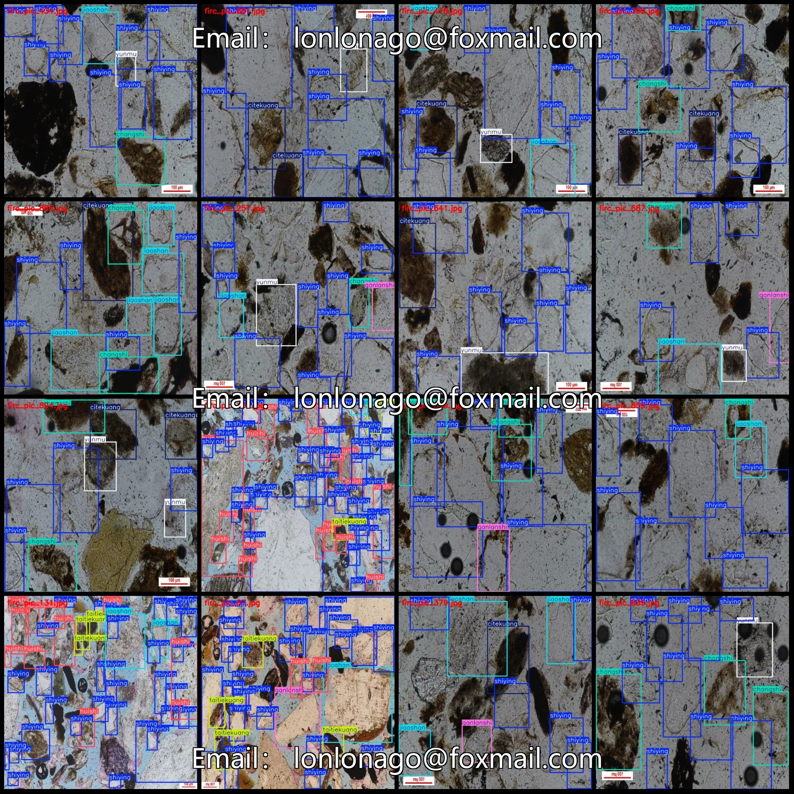
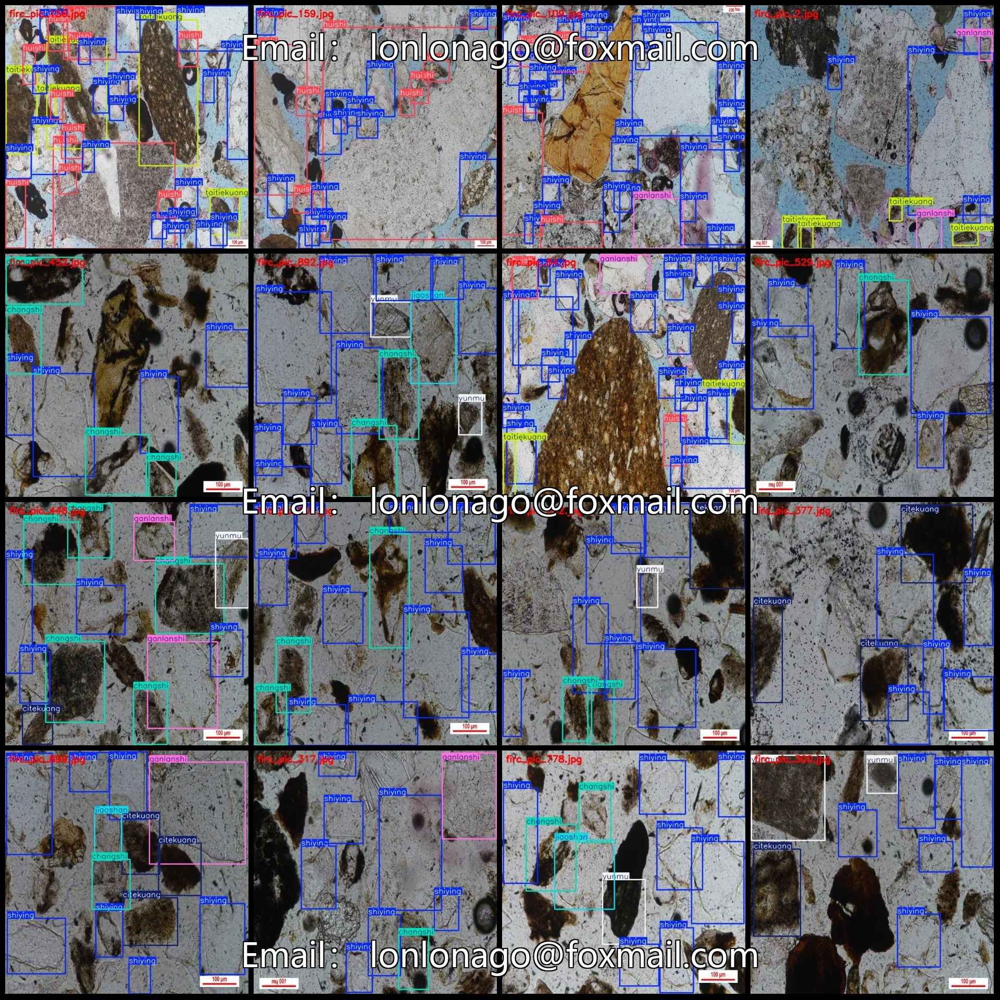
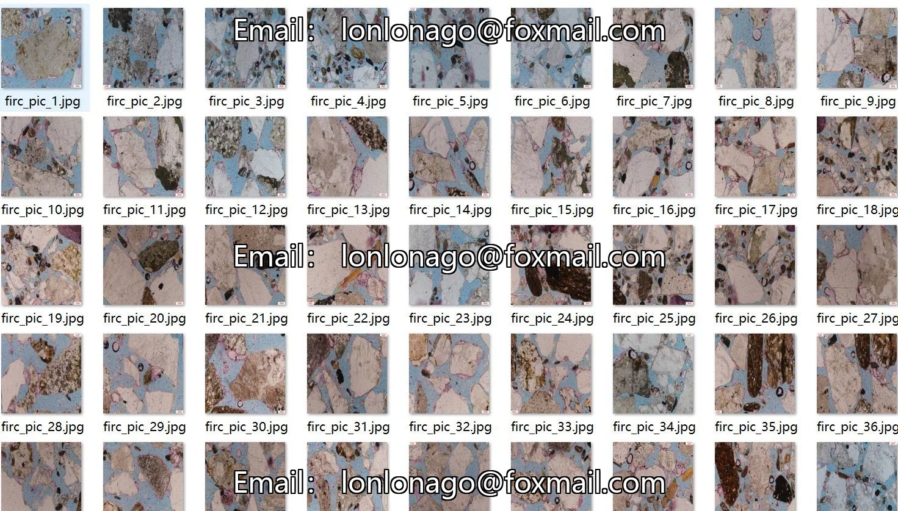
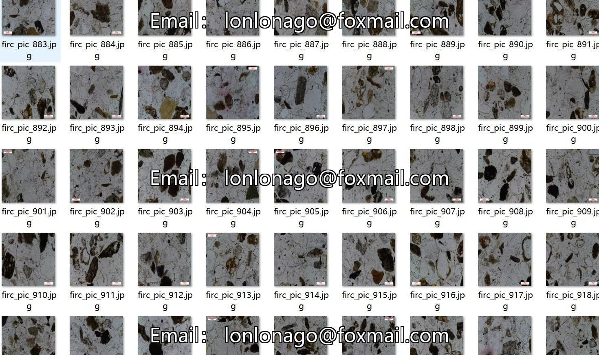
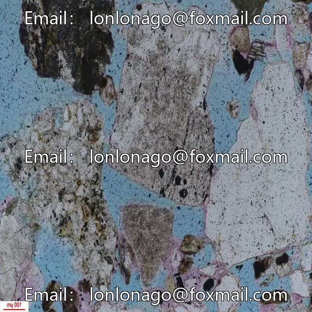
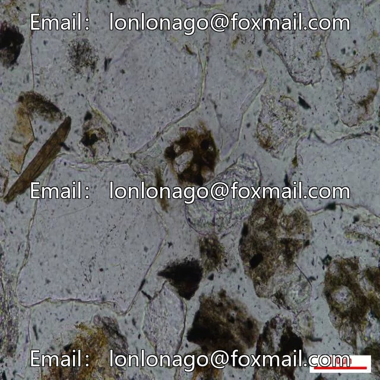
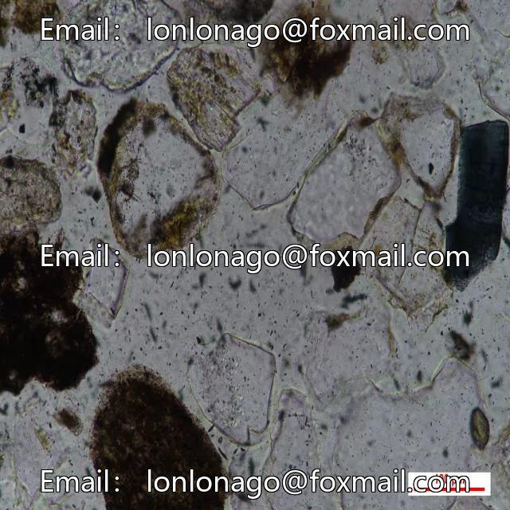

# Micro-image rock thin section mineral detection dataset VOC+YOLO format 935 images 8

## Body

Micro-image rock thin section mineral detection dataset VOC+YOLO format: 935 images in 8 categories
Note: Due to the dataset's replicability, please confirm compliance with requirements before purchasing.
Dataset format: Pascal VOC format + YOLO format (txt file without split path, only containing jpg images and corresponding VOC format xml files and yolo format txt files)
Number of images (number of jpg files): 935
Number of annotations (number of xml files): 935
Number of annotations (number of txt files): 935
Number of annotation categories: 8

Label category names (Note that the order of categories in the YOLO format does not correspond to this, but is based on the labels folder's classes.txt): ["changshi", "citekuang", "ganlanshi", "huishi", "jiaoshan", "shiying", "taitiekuang", "yunmu"]
1. Quartz
Number of boxes and the number of images occupied by each category
Changshi frame count = 1022, occupying image count = 504

Citekuang Frames = 458, Pictures = 307
Ganlanshi Frames = 459, Pictures = 360
Huishi Frames = 518, Pictures = 152
Jiaoshan Frames = 640, Pictures = 443
Shiying Frames = 8532, Pictures = 933
Taitiekuang Frames = 403, Pictures = 130
Yunmu Frames = 674, Pictures = 450
Total Frames: 12706
Picture Resolution: 640x640
Labeling Tool: labelImg
Labeling Rules: Draw a rectangle around the category.

Important Notice: The dataset does not have separate training, validation, and test sets; you need to partition them yourself.
Special : This dataset does not guarantee the accuracy of the trained models or weight files.

## Images

## Payment

Here is a pay link on Stripe ( https://buy.stripe.com/3cs8yP7sY87d0vu9AB ). Please contact me lonlonago@foxmail.com after funding $89, and I will send you a complete data files , thank you!

